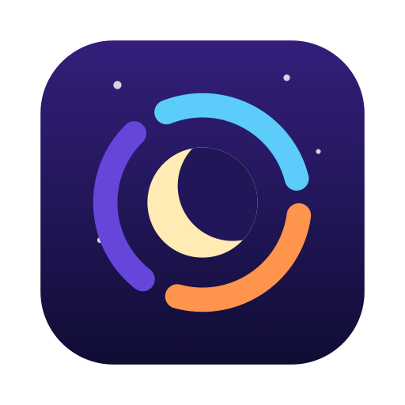
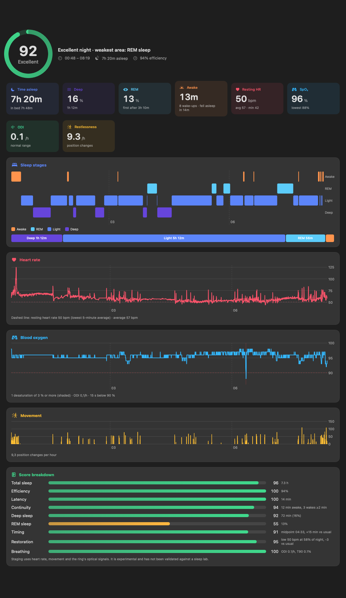
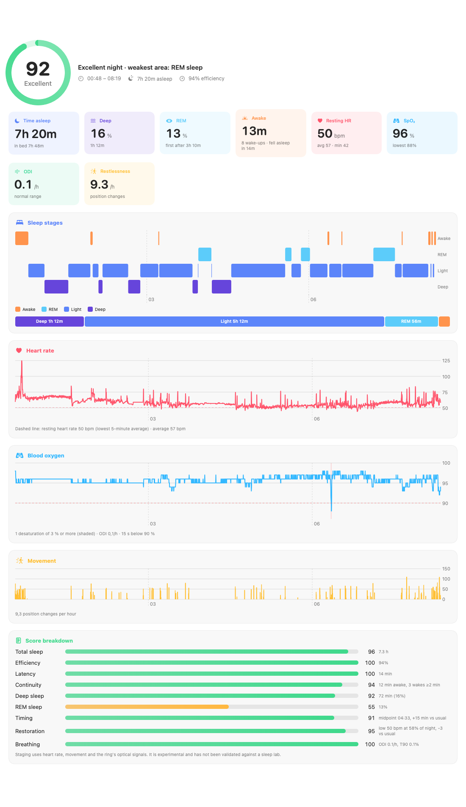
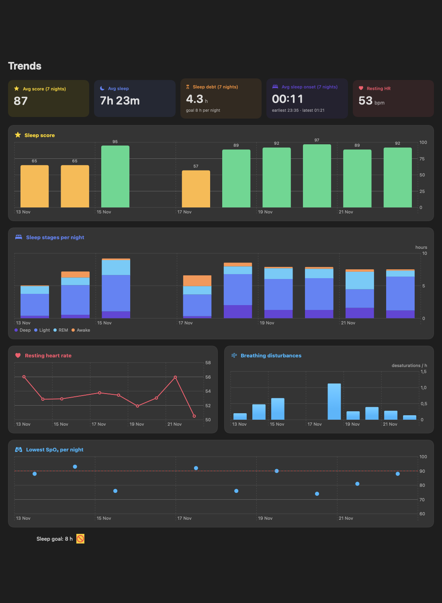
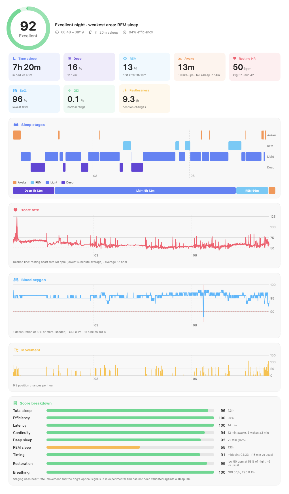

# Go2Sleep Studio

A native macOS app (SwiftUI, Swift Charts, CoreBluetooth) that replaces the phone app for the **SleepOn Go2Sleep** sleep-tracking ring. It talks to the ring directly over Bluetooth, with no account and no phone, shows live SpO₂ and heart rate, downloads the ring's per-second recordings, and scores each night with its own transparent, on-device sleep staging and scoring engine.

> Personal project, not a medical device. Sleep stages and scores are estimates and have **not** been validated against polysomnography.

<p align="center"></p>

## Screenshots

| Night dashboard (dark) | Night dashboard (light) |
|---|---|
|  |  |

| Trends | PDF night report |
|---|---|
|  |  |

## Features

- **Live:** SpO₂, heart rate, perfusion, on-finger, battery and signal strength, streamed once a second while the ring is worn.
- **Nights:** sleep score with breakdown, hypnogram (Awake / REM / Light / Deep), stage breakdown, heart rate with resting line, SpO₂ with shaded desaturations (ODI, T90, nadir), movement, PDF export.
- **Trends:** score, stage hours, resting heart rate, breathing disturbances, lowest SpO₂, 7-night sleep debt and average sleep onset.
- **Device:** firmware, serial, battery, clock sync, history download, automatic-monitoring restore, trigger sensitivity, CSV import/export.
- **Overnight robustness:** keeps the Mac awake while connected, backs up live readings, auto-downloads the ring's recording in the morning, and restores the ring's settings by itself after a battery-death reset.
- **Lab:** raw command console with a safety blocklist. **Menu bar:** live vitals and last night's score.

## Repository layout

| Path | What it is |
|---|---|
| `app/` | The Mac app. `project.yml` (XcodeGen) generates `Go2SleepStudio.xcodeproj`; sources in `app/Go2SleepStudio/Sources`. See `app/README.md`. |
| `app/Go2SleepStudio/Sources/Model/SleepEngine.swift` | Sleep staging, oximetry and score engine. |
| `research/` | Protocol notes from the decompiled official app (`apk_protocol.md`), the staging/score algorithm spec with sources (`staging_research.md`), and the official app's feature inventory (`app_features.md`). |
| `*.py`, `*.command` | The Python (bleak) tools used to reverse-engineer the ring: scanning, probing, history dump and decode, early web dashboards, overnight logger. On macOS run them through Terminal (`open -a Terminal x.command`), which has Bluetooth permission. |
| `docs/screenshots/` | Images above, rendered by the app's headless `--snapshot` mode. |

## Build

```bash
brew install xcodegen
cd app && xcodegen generate
xcodebuild -project Go2SleepStudio.xcodeproj -scheme Go2SleepStudio -configuration Release -derivedDataPath build.noindex build
```

Signing is set to a personal Apple Development identity in `app/project.yml`; change `DEVELOPMENT_TEAM` / `CODE_SIGN_IDENTITY` for your own. macOS asks for Bluetooth permission on first launch.

## Ring protocol (short version)

- Nordic UART service `6E400001-…`; write to `6E400002`, notifications on `6E400003`.
- Host frames are 20 bytes, zero-padded: `5a <cmd> 00 <args…>`. Ring frames: `5b <cmd> <status> …`.
- The ring streams `5b 40 … spo2 hr worn charging pi` by itself once a second while it detects a finger; `5a 3c 00` dumps all stored per-second records.
- **Never send** `5a 35` (erases stored data), `5a 1b`, `5a 1f`, `5a 33`, `5a 32`, `5a 02` or `5a 54` (the last two drop the link on firmware V6.3.15), and don't write `0x30`, `0x12` or `0x50` with unknown values: they change the ring's monitoring settings.

Full details and sources are in `research/apk_protocol.md`.

## Sleep staging and score

Cole–Kripke (1992) actigraphy with Webster (1982) rescoring for wake; heart-rate features adapted from Walch et al. (2019); a cycle-aware hidden Markov model with forward-backward decoding for Light/Deep/REM; AASM-style 3 % desaturation events (method after PhysioZoo `pobm`); and a 0–100 score from weighted, piecewise-linear sub-scores. Specification, design choices and references: `research/staging_research.md`.

## Credits

- Initial protocol hints: [yath/go2sleep](https://github.com/yath/go2sleep).
- Algorithms: Cole et al. 1992, Webster et al. 1982, Walch et al. 2019 ([ojwalch/sleep_classifiers](https://github.com/ojwalch/sleep_classifiers)), AASM scoring manual, [PhysioZoo pobm](https://github.com/physiozoo/pobm).

Not affiliated with SleepOn. SleepOn and Go2Sleep are trademarks of their owner.
